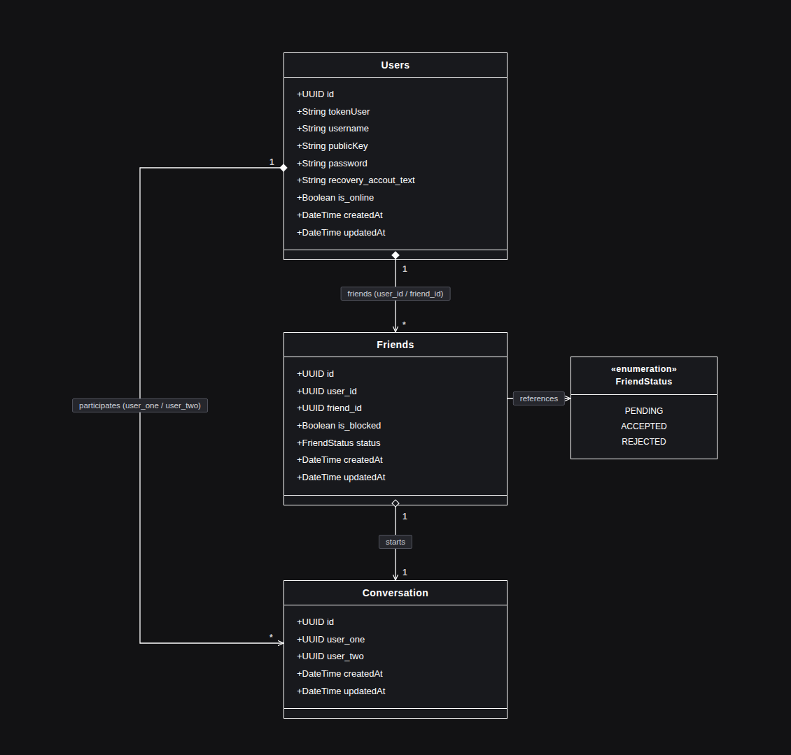
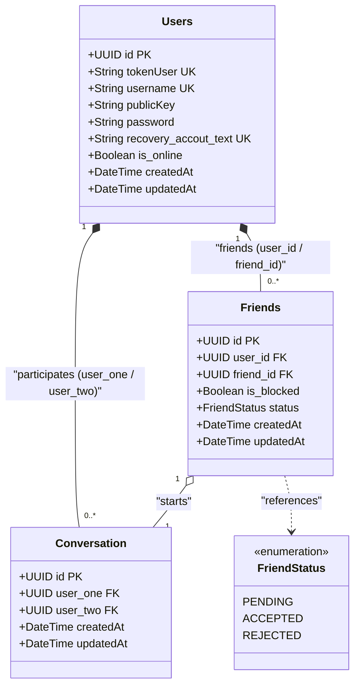

# Database UML Class Diagram (HogoBear Backend)

Ce document contient le diagramme de classes UML pour les tables de la base de données PostgreSQL / Sequelize.

## Vue Image du Diagramme UML

## Diagramme UML (Mermaid)

## Structure des tables & Relations

### 1. `Users`
- **id** (`UUID`, PK) : Identifiant unique de l'utilisateur.
- **tokenUser** (`STRING`, UK) : Token unique utilisé pour l'ajout d'amis.
- **username** (`STRING`, UK) : Nom d'utilisateur.
- **publicKey** (`STRING`, Nullable) : Clé publique pour le chiffrement de bout en bout (E2EE).
- **password** (`STRING`) : Mot de passe haché (bcrypt).
- **recovery_accout_text** (`STRING`, UK) : Phrase mnémonique (BIP) hachée pour la récupération.
- **is_online** (`BOOLEAN`) : Statut de présence en temps réel.
- **createdAt** / **updatedAt** : Horodatages automatiques Sequelize.

### 2. `Friends`
- **id** (`UUID`, PK) : Identifiant de la relation.
- **user_id** (`UUID`, FK $\rightarrow$ `Users.id`) : Utilisateur initiateur.
- **friend_id** (`UUID`, FK $\rightarrow$ `Users.id`) : Utilisateur cible.
- **status** (`ENUM: PENDING, ACCEPTED, REJECTED`) : État de la demande d'ami.
- **is_blocked** (`BOOLEAN`) : Indicateur de blocage.

### 3. `Conversation`
- **id** (`UUID`, PK) : Identifiant de la conversation.
- **user_one** (`UUID`, FK $\rightarrow$ `Users.id`) : Premier participant.
- **user_two** (`UUID`, FK $\rightarrow$ `Users.id`) : Deuxième participant.
